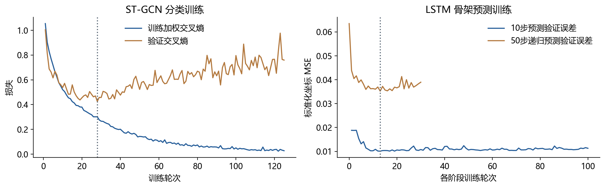

# 基于车载视频的行人过街意图预测

深度学习课程项目，包含行人骨架提取、未来骨架预测、时空图卷积分类，以及可操作的本地演示界面。最终提交版本为 **v2.0.0**。

```text
车载视频 → YOLO26s-Pose → ByteTrack → 50次历史骨架
         → LSTM递归预测50步骨架 → ST-GCN → 其他 / 不过街 / 过街
```

LSTM保持10层、256维隐藏状态，ST-GCN保持原有10个时空卷积块。LSTM以最近一次骨架为参照学习变化，分类器使用交叉生成的预测骨架训练，类别损失按频数平方根倒数加权。最终选用LSTM短期第13轮与递归训练第13轮、ST-GCN第28轮。视频、网页和摄像头行为预测共用 `weights/final/` 中的权重、训练统计量与配置。

## 实验结果

| 评价方式 | 样本数 | Accuracy | Macro-F1 |
|---|---:|---:|---:|
| 最终模型验证集 | 368 | 88.86% | 0.6915 |
| 最终模型测试集 | 1506 | **82.40%** | **0.5368** |
| 历史骨架直接分类（同设置消融） | 1506 | 78.02% | 0.4639 |

数据按视频分为176段训练、44段验证、126段测试视频。测试集4189个候选点中1506个产生有效预测，覆盖率35.95%。分类标签为行人级crossing属性；测试视频此前已用于项目开发，以上结果不表示在某个固定提前时间的预测准确率。

加入LSTM后准确率提高4.38个百分点，Macro-F1提高0.0729；分类别指标、混淆矩阵、配对区间与类别权重实验见 [最终实验记录](docs/final/v2_20261102/README.md)。



## 安装与演示

已验证：Windows、Python 3.9、PyTorch 2.2.2+cu121、RTX 4060 Laptop。新环境示例：

```powershell
python -m pip install torch==2.2.2 torchvision==0.17.2 --index-url https://download.pytorch.org/whl/cu121
python -m pip install -r requirements-base.txt
$env:SRTP_MODERN_HOME = Join-Path $PWD 'artifacts'
python -m pip install --target "$env:SRTP_MODERN_HOME\runtime\site-packages" --no-deps -r modern_pipeline/requirements-modern.txt
python download_final_models.py
python -s run_demo.py --input "输入视频.mp4" --output "output/demo.mp4"
```

下载脚本从 [v2.0.0 Release](https://github.com/WeisMaple/srtp-pedestrian-intent/releases/tag/v2.0.0) 获取模型包，校验SHA256后安装到 `weights/final/`。旧模型目录不匹配时，先将旧目录改名保留，再下载。模型权重和课程报告、PPT通过Release分发；完整JAAD数据不随仓库上传。

网页演示需安装 `requirements-web.txt`、配置FFmpeg，并在 `web_demo` 运行 `npm install` 和 `npm run build`，随后执行：

```powershell
python run_web_demo.py
```

打开 `http://127.0.0.1:8765`，上传道路视频并开始分析。网页支持结果视频、骨架序列、空间/时间卷积、逐项数值讲解与结果导出。详细步骤见 [网页说明](docs/WEB_DEMO.md)。本机已配置环境可运行 `run_final_web.ps1`。

摄像头模式运行 `python -s run_camera_demo.py --camera 0 --backend dshow --behavior`。该入口同样读取最终模型包；道路区域按四角点击后按Enter确认，R重选、C清空历史、Q退出。摄像头采用时间重采样，教室场景主要用于展示骨架与跟踪，参见 [摄像头说明](docs/CAMERA_DEMO.md)。

## 验证与文件

- [课程提交说明](docs/COURSE_SUBMISSION.md)：成员分工、课堂演示和材料。
- [数据说明](data/PROJECT_DATA.md)：JAAD、样本形状、划分与训练入口。
- [模型清单](docs/FINAL_MODEL.md)：最终权重、统计量与评价范围。
- `modern_pipeline/`：PyTorch推理、跟踪缓存与可视化采样；`st_gcn.py`：LSTM/ST-GCN网络定义。
- `independent_20261028/final_training_20261102/`：实际训练与分析脚本。

```powershell
python -m unittest discover -s modern_pipeline/tests
cd web_demo
npm test
npm run build
```

本机通过110项Python测试与68项前端测试；150帧视频实测关闭/开启计算采样为14.72/14.38 FPS，两者逐帧预测记录一致。YOLO使用GPU，LSTM/ST-GCN使用CPU。历史实验保留在归档目录，当前指标以 `docs/final/v2_20261102/` 为准。第三方来源与许可证见 [THIRD_PARTY_NOTICES.md](THIRD_PARTY_NOTICES.md)。
