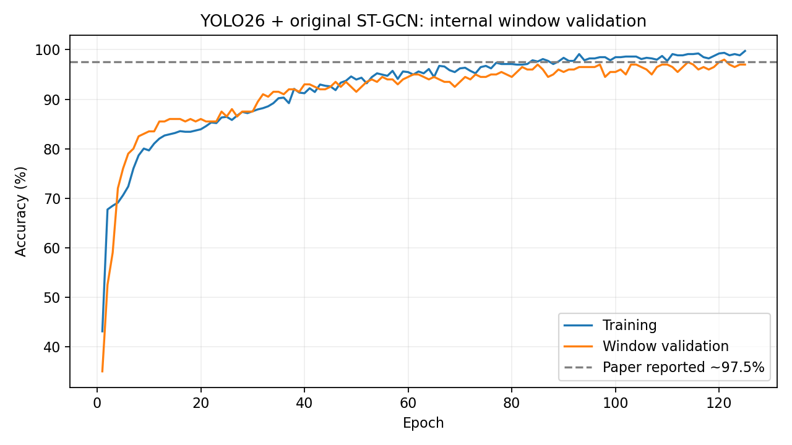

# 基于人体骨架时序建模的行人过街意图预测

本项目用于**深度学习课程大作业**，包含模型推理、视频可视化和可操作的本地网页演示。

课堂提交版本：**v1.0.0**。系统从车载视频提取行人骨架，使用LSTM预测骨架序列，再由ST-GCN输出类别，并显示行人框、骨架、跟踪ID和预测结果。

```text
视频 → YOLO26s-Pose → ByteTrack → 50次骨架观测
     → LSTM递归预测未来骨架 → ST-GCN分类 → 可视化视频
```

保留论文的17点骨架及原LSTM、ST-GCN网络结构。最终分类权重固定为内部验证第121轮，LSTM使用已有YOLO26骨架训练、按验证MSE选中的第68轮权重。两者分别训练；视频流程按原固定参考归一化运行。

## 最终分类模型指标

以下是**单独ST-GCN的200个内部验证窗口**上的结果，重新加载权重后复核：

| 指标 | 数值 |
|---|---:|
| Accuracy | 98.00%（196/200） |
| Macro Precision | 97.16% |
| Macro Recall | 95.19% |
| Macro-F1 | 0.9614 |
| Weighted-F1 | 0.9798 |

内部验证有195/200个窗口与训练历史重叠，归一化在划分前计算；这些分数不是独立视频或LSTM→ST-GCN完整流水线的准确率。最终组合的视频检查用于验证运行，不能沿用其他权重组合的81.51%等分数。完整类别指标见 [指标明细](docs/final/指标明细_20261029.txt)。



## 安装与运行

已验证环境：Windows、Python3.9、PyTorch2.2.2+cu121、RTX4060 Laptop。已有本机d2l环境可直接使用；新环境示例：

```powershell
python -m pip install torch==2.2.2 torchvision==0.17.2 --index-url https://download.pytorch.org/whl/cu121
python -m pip install -r requirements-base.txt
$env:SRTP_MODERN_HOME = Join-Path $PWD 'artifacts'
python -m pip install --target "$env:SRTP_MODERN_HOME\runtime\site-packages" --no-deps -r modern_pipeline/requirements-modern.txt
python download_final_models.py
python -s run_demo.py --input "path/to/video.mp4" --output "output/demo.mp4"
```

模型包从 [v1.0.0 Release](https://github.com/WeisMaple/srtp-pedestrian-intent/releases/tag/v1.0.0) 下载，脚本校验SHA256并安装至 `weights/final/`。模型权重通过Release分发，不放入Git历史。输入视频由使用者提供，JAAD数据集不随仓库分发。

本机也可运行：

```powershell
.\run_demo.ps1 -InputVideo "视频路径" -OutputVideo "新输出路径.mp4"
```

输出包含MP4、逐帧JSONL和运行指标。`Collecting motion`表示积累历史；`score`是类别概率分数，不是实测准确率；`Other`对应JAAD的irrelevant类别。请使用尚未存在的输出路径。

## 摄像头现场试跑

独立的试验入口支持固定摄像头、鼠标划定模拟道路、骨架与轨迹外推。使用已有环境和本地 YOLO26 Pose 权重运行：

```powershell
python -s run_camera_demo.py --camera 0 --backend dshow
```

沿道路四角依次点击，按 Enter 开始；R 重划、C 清空历史、Q 退出。加 `--behavior` 可单独显示原 LSTM → ST-GCN 的输出，需另外准备行为权重。轨迹外推和模型结果分别标注；该入口使用时间重采样，不属于已验证的离线评估流程。环境、日志、参数和限制见 [摄像头演示说明](docs/CAMERA_DEMO.md)。

## 文件说明

本地网页演示支持选择视频、开始分析、骨架与行人 ID、预测类别、结果保存，以及实际推理驱动的三维计算展示、输入→权重→乘积→累加→输出的逐项演算、参与关系筛选和详细数值回放。按 [网页演示说明](docs/WEB_DEMO.md) 完成一次前端构建后，运行 `python run_web_demo.py`，打开 `http://127.0.0.1:8765`。

- `run_demo.py` / `run_demo.ps1`：最终视频展示入口，默认载入固定模型包。
- `run_web_demo.py` / `web_demo/`：本地网页工作台、实时三维计算与数值回放。
- `run_camera_demo.py`：模拟道路摄像头演示，独立于默认离线流程。
- `modern_pipeline/`：检测、跟踪、时序缓存、行为预测和可视化。
- `st_gcn.py`：保留的原ST-GCN及LSTM结构。
- `docs/final/`：固定模型配置、文件校验值与指标。
- [最终模型说明](docs/FINAL_MODEL.md)：组件来源、评测范围和运行核验。
- [实验归档](docs/experiments/README.md)：历史实验记录，归档分数不代表当前最终组合。

验证命令：`python -s -m unittest discover -s modern_pipeline/tests -p 'test_*.py' -v`。

摄像头试验入口另有 25 项测试；与原有 26 项回归测试一起运行。缺少复现权重时，5 项真实权重行为测试自动跳过，须在验证结果中明确报告。

项目依据原论文《基于车载视频的行人意图预测方法的设计与实现》及恢复代码。第三方代码和模型的来源、许可证见 [THIRD_PARTY_NOTICES.md](THIRD_PARTY_NOTICES.md)，模型包另附来源说明。
