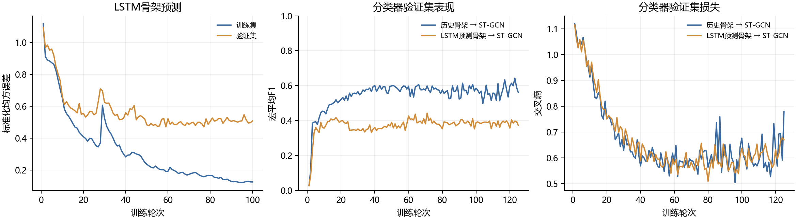
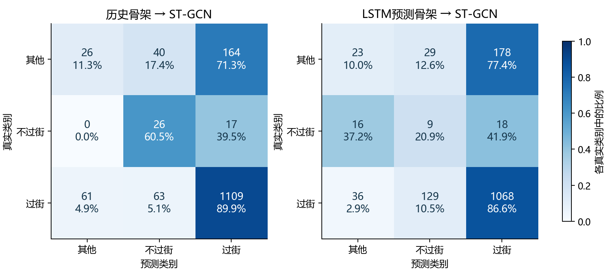

# 保持模型结构的LSTM配对重训练实验

加入LSTM后，测试集宏平均F1降低了0.0845，准确率变化为-4.05个百分点。按视频进行配对重采样得到的差值区间跨过0，因此当前数据尚不足以确认稳定的分类收益。

## 训练与数据处理

YOLO26s-Pose、ByteTrack、10层LSTM和10块ST-GCN的网络结构保持原样。实验复用346段视频的原始检测与骨架缓存，没有增加姿态平滑。分类输入严格按检测跟踪身份和时间积累；人工标注只用于同帧边界框匹配和类别赋值，不修补历史轨迹。

训练、验证、测试分别包含176、44、126段视频，三者无视频交集。训练和验证的分类窗口分别为1648、368，类别数量依次为[241, 91, 1316]、[26, 16, 326]。LSTM训练使用1835组50步历史/10步未来骨架，验证使用396组；监督目标来自同一检测轨迹的后续关键点观测。

训练/验证划分沿用此前依据类别人数确定的视频分组；原测试视频保持不变。测试视频曾用于早期项目开发，本次两条新训练路径均未用测试数据拟合参数或选模。

LSTM使用训练集的逐关节、逐通道均值与标准差，Adam学习率0.001、batch_size=128、100轮，按验证MSE选模。训练分类器的预测骨架由三折按视频交叉训练生成：一个训练视频的预测来自未使用该视频训练的LSTM。验证与测试预测来自完整训练集拟合的主LSTM。

两个分类器分别适应历史观测骨架和预测骨架。各自的标准化统计量只从训练输入计算，并由实际推理函数原样复用。两者具有相同初始权重、训练样本顺序、SGD学习率0.001、batch_size=128和125轮预算。交叉熵按训练类别数量的倒数加权；按验证集宏平均F1选模，平分时选验证交叉熵较低者。随机种子固定为2026。

主LSTM选中第77轮；历史骨架分类器选中第123轮，预测骨架分类器选中第71轮。

## 同一测试集上的配对结果

两条路径共同评价1506个有效点，候选点总数4189，覆盖率为35.95%。类别数量为[230, 43, 1233]。所有输出点的输入历史与标签完全一致。

| 路径 | 准确率 | 宏平均F1 | 其他召回率 | 不过街召回率 | 过街召回率 |
|---|---:|---:|---:|---:|---:|
| 历史骨架 → ST-GCN | 77.09% | 0.4485 | 11.30% | 60.47% | 89.94% |
| LSTM预测骨架 → ST-GCN | 73.04% | 0.3640 | 10.00% | 20.93% | 86.62% |

按视频进行2000次配对重采样，准确率差值的95%区间为[-9.20, +2.55]个百分点；宏平均F1差值区间为[-0.1886, +0.0621]。该区间反映测试视频组成的变化，不包含多随机种子训练的不确定性。

## 骨架预测误差与速度

在测试视频的1523组10步预测样本上，LSTM标准化MSE为0.3839；将最后一次观测直接重复10次的参照MSE为0.1522。只计算横纵坐标时，两者MSE分别为0.1406和0.0171。这些误差针对后续YOLO骨架观测。

| 路径 | GPU单人行为推理中位延迟 | 视频处理速度（不编码，两次中位值） |
|---|---:|---:|
| 历史骨架 → ST-GCN | 4.31 ms | 42.04 FPS |
| LSTM预测骨架 → ST-GCN | 120.75 ms | 18.54 FPS |

单人延迟统计对同一批64个历史窗口重复3次，预热后计时，包含输入/输出传输，YOLO不计入该项。视频测试使用同一段1920×1080视频的前150帧，YOLO在GPU运行，行为模型在CPU运行；两条路径的检测、跟踪和采样设置一致。测速采用预热后的两次不编码运行；首轮生成的视频用于检查显示效果，不纳入速度汇总。

## 核对与使用

已验证视频划分互斥、交叉预测不使用本视频训练、训练统计量来源、两条路径评价点一致、重新加载权重后指标一致，以及训练特征与实际推理输出一致。网络结构文件及当前演示权重的哈希均保持不变。详细记录见verification.json和runtime_parity.json。

模型分别保存在observed/best.pt和forecast/best.pt；主LSTM为lstm/best.pt。每条路径必须配套使用本目录中的normalization.pt。training_stats是两条新路径共同的推理方式。旧报告中的内部98%和旧全流程诊断采用不同训练与评价设置，保留为原版本实验记录。

类别标签沿用JAAD的行人级过街属性。本次实验比较两条处理路径的分类效果，过街开始前不同提前量的评价可作为后续实验。

## 递归预测检查

使用具有完整50步后续观测的831组测试序列，分别计算每10步的标准化坐标MSE。

|未来观测范围|LSTM预测|保持最后观测不变|
|---|---:|---:|
|1—10|0.1122|0.0109|
|11—20|0.1489|0.0448|
|21—30|0.2128|0.1100|
|31—40|0.2953|0.2150|
|41—50|0.3991|0.3671|

五个区间内，LSTM坐标误差均高于保持最后观测的参照。训练/推理的一致性核对已通过，这组结果表明当前骨架预测质量仍不足，后续应优先检查骨架预测的监督目标与训练策略。
